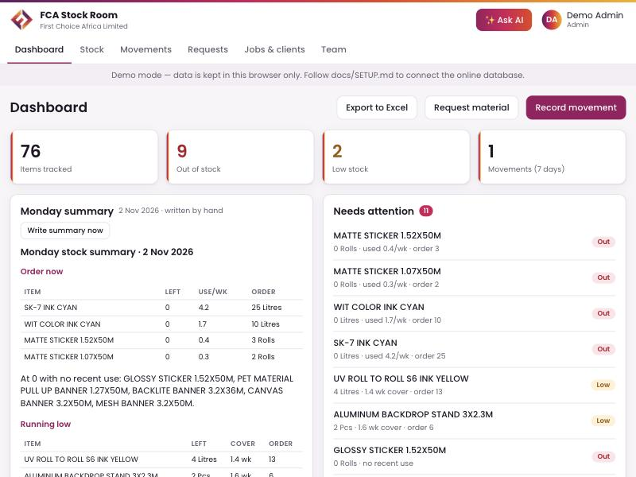
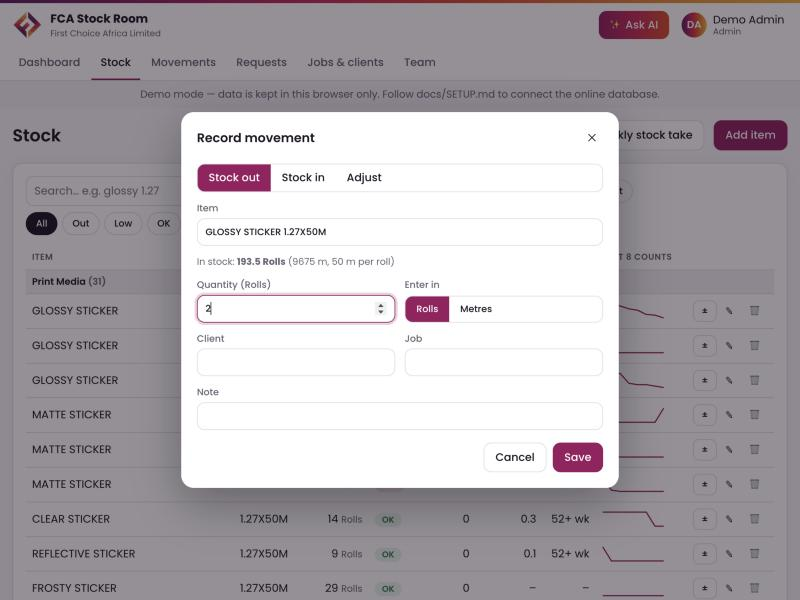
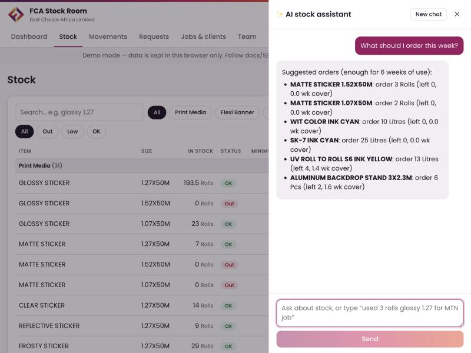
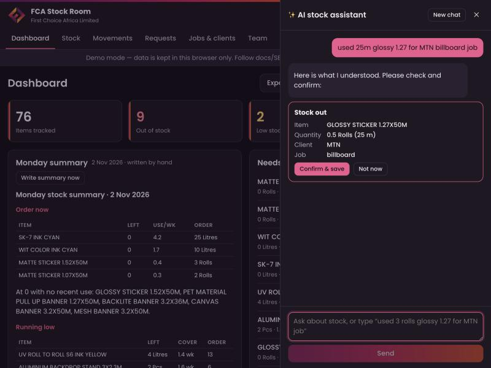
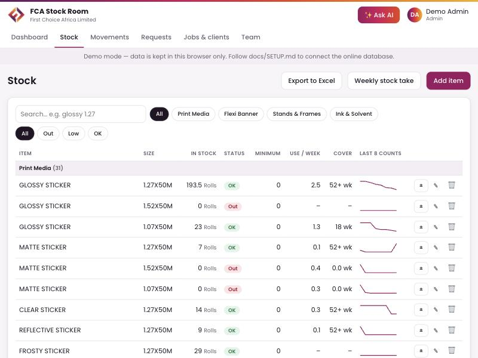
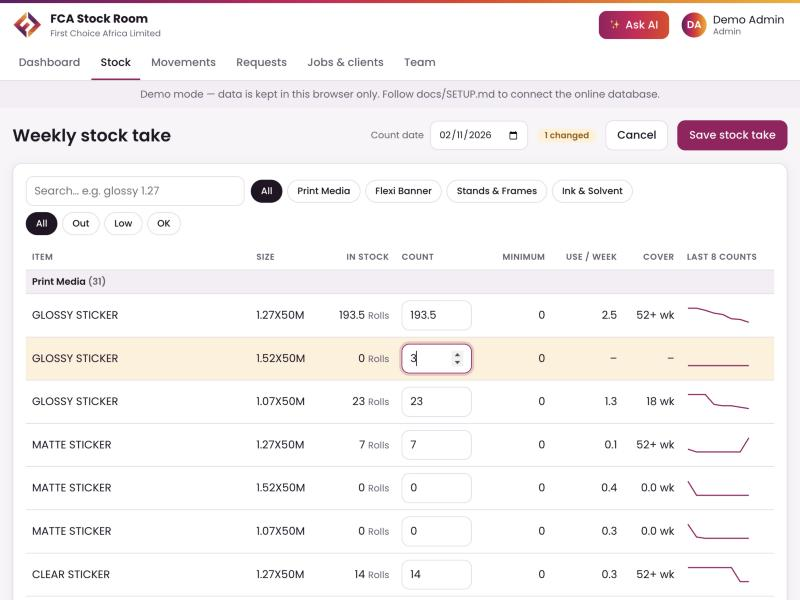

# First Choice Africa Ltd — User guide

For everyone at First Choice Africa Limited. Each section says who can do it.

**Roles:** **Admin** (one person, can do everything) · **Boss** and **Manager** (run the stock) · **Staff** (record stock in and out, ask for material) · **Viewer** (just the Job calculator: no stock, movements or team).

---

## Signing in

- **Website:** open the address your Admin gives you. On a phone you can add it to the home screen (iPhone: Share → *Add to Home Screen*; Android: menu → *Install app*).
- **Desktop app:** open **FCA Stock Room** from Applications (Mac) or the Start menu (Windows).
- First time: **Create account** with your name, email and a password (at least 8 characters). You start as **Staff** until the Admin changes your role.
- Forgot your password: **Forgot password?** → enter your email → click the link in the email.

Your name, photo and role are shown at the top right. Click them for: theme (light/dark), **Turn on notifications**, the printable stock-take sheet, and **Sign out**.

**No internet?** You can keep working. An orange **Offline** bar appears; your changes are kept on the device and sent automatically when the internet comes back. Nothing is lost or counted twice.

---

## Dashboard — everyone

- **Tiles**: items tracked, out of stock, low stock, movements in the last 7 days. Click a tile to open the matching list.
- **Monday summary**: written automatically every Monday at 07:37, and emailed to Admins, Bosses and Managers. It lists what to **order now**, what is **running low**, the biggest stock outs and clients of the week, pending requests, and whether this week's stock take was done. *Managers/Bosses/Admin* can press **Write summary now**.
- **Needs attention**: items that are out, at/under minimum, or with less than 3 weeks of stock left.
- **Fastest moving**: average use per week.
- **Ink by machine**: a bottle per colour for SK-1, SK-7, UV Flatbed R8, UV Roll To Roll S6 and WIT Color. A red outline means it is at or under its minimum.
- **Latest movements**: who did what, most recent first.

### What the numbers mean

- **Use / week**: average of how much the weekly counts went down (last 9 counts). Big one-off drops that look like count corrections are ignored.
- **Cover**: how many weeks the stock will last at that use.
- **Status**: **Out** = 0 left · **Low** = at/under minimum or under 3 weeks of cover · **OK**.
- **Suggested order**: enough for 6 weeks of use (or the minimum, if higher), minus what's left.

---

## Recording stock in and out — Staff, Managers, Bosses, Admin

1. Press **Record movement** (Dashboard), or **±** next to an item on the Stock page.
2. Choose **Stock out** (used for a job) or **Stock in** (delivery). *Managers* also see **Adjust** for corrections (a reason is required).
3. Type part of the item name and size, e.g. `glossy 1.27`, and pick it from the list.
4. Enter the quantity. **For rolls you can switch to Metres**: e.g. 25 m of a 50 m roll is saved as 0.5 roll.
5. Fill in **Client** and **Job** for stock outs, so the *Jobs & clients* page and the Monday summary are accurate.
6. **Save.** You can't take out more than is in stock.

Every movement is saved with your name and the time, and can never be deleted. Mistakes are reversed by a Manager, Boss or the Admin (see Movements).

---

## Asking the AI assistant — everyone

Press **✨ Ask AI** (top right). Ask in plain words, for example:

- "How many glossy 1.27 rolls do we have?"
- "What should I order this week?"
- "What is running low?"
- "Which clients used the most material this month?"

You can also tell it what happened: **"used 3 rolls glossy 1.27 for MTN job"** or "received 10 sheets foam board 5mm". It shows a **card** with the item, quantity, client and job:

Nothing is saved until you press **Confirm & save**. If it picked the wrong item, press **Not now** and ask again more precisely. The assistant can only do what your role allows. Press **New chat** to start over.

---

## Requesting material — Staff (and everyone except Viewers)

1. **Request material** (Dashboard) or **Requests → New request**.
2. Choose the item, quantity, client, job and a note.
3. A Manager approves or rejects it. The **Requests** tab shows a red number for pending requests.

**Managers/Bosses/Admin:** on **Requests**, press **Approve** (this records the stock out automatically) or **Reject**. *Approve* is greyed out if there isn't enough stock. Use the chips **Pending / Approved / Rejected / All** to filter.

---

## Stock list — everyone

- Grouped by category, with stock, status, minimum, use per week, weeks of cover and a small line of the last 8 counts.
- **Search** with words in any order: `glossy 1.27`, `foam 5mm`, `sk-7 cyan`.
- Filter by **category** and **status** (Out / Low / OK).
- **Export to Excel** saves the list with today's date in the file name.

**Managers/Bosses/Admin:**
- **Add item**: name, size, category, unit, minimum and starting stock. For rolls write the size as `1.27X50M` (width X length) so metres work. For ink, put the machine in the name (`SK-7 INK`) and the colour in the size (`CYAN`).
- **✎ Edit** an item (e.g. to set its **minimum**). Changes are logged.
- **🗑 Remove** an item. It disappears from the list but stays in the movement log.

> **Tip:** minimum levels were not in the old Excel, so they start at 0. Set a sensible minimum for each item; it makes "Low" and the order suggestions much more useful.

---

## Weekly stock take — Managers, Bosses, Admin

1. Optional: print the sheet first (top-right menu → **Print stock-take sheet**) and count on paper.
2. **Stock → Weekly stock take.** Every item gets a box with the current number.
3. Type the counted number wherever it differs. Changed rows turn yellow and the counter shows how many changed.
4. Check the **Count date**, then **Save stock take**.

This records the count for **every** item (this builds the history used for "use per week") and logs a *Count* movement for each item that changed. Do it once a week, ideally on the same day. The Monday summary reminds managers if no stock take was saved in the last 8 days.

---

## Job calculator — everyone (Take from stock: Staff and up)

The SQM & Wastage Calculator is part of the Stock Room, with everything it had before.

1. **Job calculator** tab: fill in the job, client, who prepared it, the date and whether to add bleed.
2. Add each **location** and its **items**: name, material, width × height in cm, quantity. Each item shows its real SQM and which roll it is on (or the panels it needs if it is wider than the roll).
   - **Quick add:** type or paste items into the box under the items, one per line, e.g. `Banner, 2x3m - 12 pcs` or `Window sticker 90 x 120 cm 4 pcs`. You can also paste cells copied from Excel (name, width, height, quantity). Check the green preview, then press **Enter** or **Add items**. Lines without a size stay in the box.
   - **Import pictures…** (or drag files onto a location): the print size is read from PDF, Illustrator, EPS and SVG files, and from JPG/PNG/TIFF files that have a print size (dpi). Pictures without a print size come in with an empty size for you to type.
   - If an item's name says a different material than the one chosen (e.g. "Clear sticker" set to Glossy Sticker), a **Move it to…** button fixes it.
3. **Material use** under each location shows the roll width chosen (and the other widths tried), running metres, total and wastage.
4. On the right: **Stock to pull** (which stock item and how much is in stock) and a **preview of the report**, exactly as the PDF will look.
5. **Download PDF report** saves the two-page First Choice report: job details, summary, summary by item, notes, and *Material to pull from stock*.
6. **Open PDF report** opens a report made by the job calculator (or by the old SQM & Wastage Calculator) so you can change the job. **Undo** puts back the job you had before.
7. **Take from stock** records the stock-outs for you: check that each line uses the right stock item and quantity (metres are converted to rolls automatically), then **Record stock out**. Client and job are filled in, so they show on *Jobs & clients*.

**Managers/Bosses/Admin:** *Add or edit materials* sets roll widths (list every width you stock, e.g. 152, 127, 107; the calculator picks the one with least wastage), sheet sizes, bleed, panel overlap, and which stock item each material is taken from ("Auto" matches by name and width). A new material typed in quick add (e.g. "Frosty Sticker") is added to the list for you; check its roll widths. When Staff type a material that is not in the list, it is used for that job only.

The job you are working on is kept on your device until you press **New job**.

---

## Movements — everyone

The full log: when, item, type, change, balance after, client · job · reason, and who.

- Filter by search text, type, person and period (7 / 30 / 90 days / all).
- **Export to Excel.**
- **Managers, Bosses and Admin — Reverse:** press **Reverse**, write the reason (required, e.g. "entered twice"), then **Reverse**. The stock goes back and the line is crossed out. It stays in the log forever, with a new *Reversed* line showing who reversed it and why.

---

## Jobs & clients — everyone

How much material each client (or each job) used, from stock outs and approved requests. Choose **Per client** or **Per job**, a period, and search. **Export to Excel** for invoicing or checking.

---

## Team & roles — Admin only

- Only the Admin sees the **Team** tab: everyone who has signed in, with their role and when they were last seen. Other people cannot see the team list.
- **Admin:** change anyone's role with the drop-down. There must always be at least one Admin. Choose **Viewer** for people who should use the Job calculator and nothing else.
- The table shows exactly who can do what. These rules are enforced by the database, so they can't be bypassed.
- **Admin:** **Import from Excel** (add items and count history from a spreadsheet, with a preview before saving) and **Download full backup** (everything in one Excel file).

---

## Notifications

Click your name → **Turn on notifications** on each device where you want the Monday summary alert (phone, computer). The desktop app shows an alert when a new summary arrives while it's open.

## Good habits

- Log every stock out **when it happens**, with client and job.
- Do the stock take weekly.
- Keep minimum levels up to date.
- If a number looks wrong, tell a Manager. Don't delete or re-enter; ask a Manager to reverse the wrong movement.
